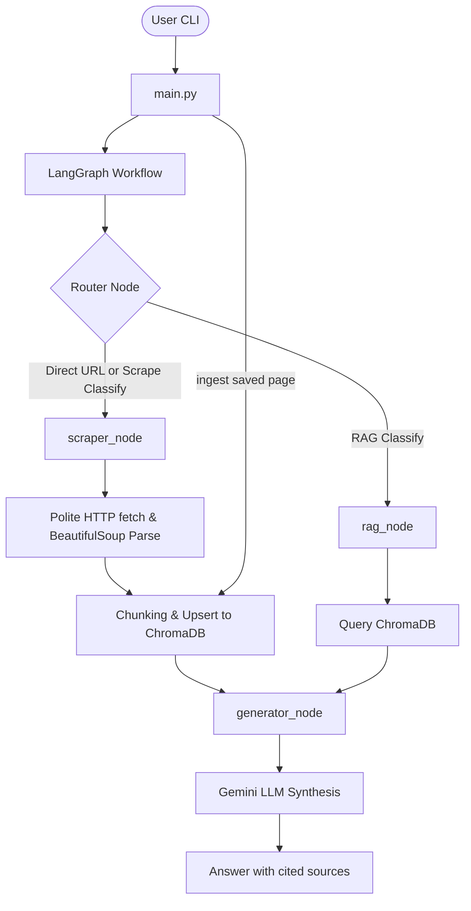

# RAG-Scrape

A Retrieval-Augmented Generation (RAG) pipeline over community forum threads, orchestrated with LangGraph, designed to surface valuable and hard-to-find knowledge from local forums.

---

## 1. Why I Built It

There is a wealth of region-specific, highly localized, and hidden knowledge buried deep inside local community forums (like Voz).
Finding this information manually is time-consuming, as threads can span dozens of pages filled with spam, noise, and off-topic discussions.
I built this tool to fetch (politely), chunk, index, and query forum discussions.
It enables users to extract valuable technical insights and local community sentiments instantly and systematically, saving hours of manual reading.

---

## 2. System Architecture

The application uses a hybrid agentic flow built on LangGraph:



### Key Technical Decisions
* **LangGraph Control Flow:** Orchestrates state transitions between scraping, database retrieval, and answer generation.
* **ChromaDB Storage Layer:** Swaps dynamically between a local in-process DB (`PersistentClient`) and a standalone server container (`HttpClient`) depending on environment variables.
* **Polite Fetching, No Bypassing:** Plain HTTP with an honest User-Agent, a `robots.txt` check, and a 2-second per-host rate limit; only network and server errors are retried.
  If a site answers with an anti-bot challenge, the tool stops instead of solving it, and you can save the page from your browser and `ingest` it.
  Voz's `robots.txt` content signals allow reference use and forbid AI training; this tool only indexes threads locally to answer questions and trains nothing.
* **Per-Post Chunks with Citations:** Each forum post is indexed on its own with its author, time, and permalink; quoted replies are dropped so the same text is not indexed twice.
  The answer cites the numbered context as `[1]`, `[2]`, and the source list under it is built from stored metadata, so links cannot be invented by the model.
  Forum text is passed to the model as data, with an explicit instruction to ignore any requests inside it.
* **Structured Logging & Tracing:** Outputs logs as single-line JSON (`LOG_FORMAT=json`) in production, with dependency log levels optimized, and integrates full execution tracing via Langfuse.

---

## 3. Getting Started

### Local Installation
1. Ensure you have Python 3.12+ and [uv](https://github.com/astral-sh/uv) installed.
2. Clone the repository and install all dependencies:
   ```bash
   uv sync --all-extras --dev
   ```
3. Copy the `.env.example` file to `.env` and fill in your Gemini API key:
   ```bash
   cp .env.example .env
   ```

### Docker Setup
You can run the entire system, including a standalone ChromaDB server, using Docker Compose:
1. Copy `.env.example` to `.env` and configure your API keys.
2. Build and start the services:
   ```bash
   docker compose up -d
   ```

---

## 4. CLI Operation and Commands

The tool exposes two subcommands and one global flag.

### Command 1: Ask Questions
Ask a question.
The router decides whether to answer from the locally indexed threads (RAG) or to fetch the thread you point it to:
```bash
# Ask using existing database history
uv run python main.py ask "Mọi người khuyên học Python ở đâu?"

# Fetch a specific thread politely, index it, and answer based on it
uv run python main.py ask "Tóm tắt thớt này giúp tôi" --url "https://voz.vn/t/hanh-trinh-tu-hoc-python-100-ngay.1178261/"
```

### Command 2: Index a Saved Thread Page
If a forum refuses automated requests, open the thread in your browser, save the page as HTML, and index the file.
The source URL is taken from the page's canonical link, or from `--url`:
```bash
# Local Execution
uv run python main.py ingest thread.html

# Docker Execution
docker compose run --rm -v "$PWD/thread.html:/app/thread.html" app ingest thread.html
```

### Reset the Vector Database
Clear all indexed threads and reset the ChromaDB database collection:
```bash
uv run python main.py --reset-db
```
